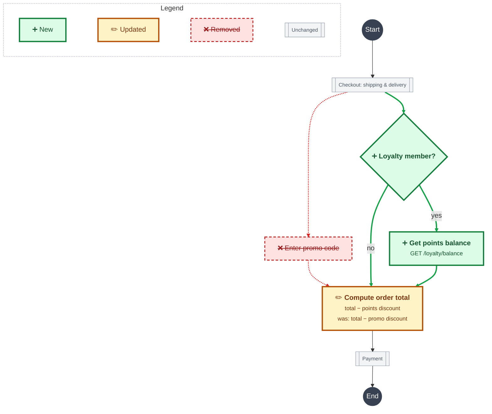
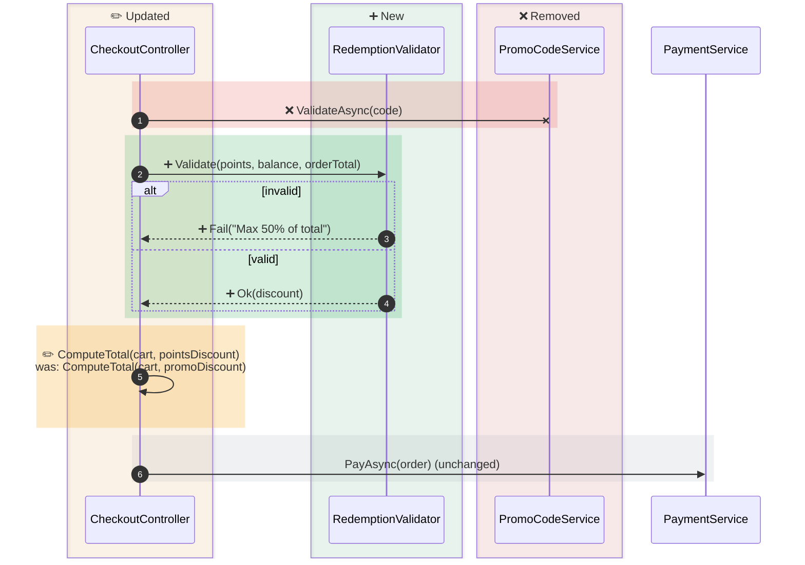

Step 1 — do this now, immediately, with no questions asked:

Create a file at "$1/$0.md" (create the folder "$1" first if it doesn't exist yet). Write only this
skeleton into it, nothing else:

```
# $0

## Functional

### Goal

### Scope

### Out of scope

### Business rules

### Activity diagram

## Technical

### Sequence diagram

### File structure

### Assumptions

### Seams

### Tests

## Generation

- Create or change the files listed in **File structure**.
- Implement the classes and calls drawn in the **Sequence diagram**.
- Remove everything marked ❌ in the **Activity diagram** and the **Sequence diagram**.
- Make the code satisfy every **Business rule**.
- Respect **Out of scope** and **Assumptions**.
- Add or update the unit tests listed in **Tests**, only at the seams listed in **Seams**, and make sure they all pass.
- Every **Business rule** must be covered by at least one passing unit test.
- Do not change anything this file doesn't cover.
- If two sections contradict each other, or something needed is missing, stop and ask before going on.
```

Do not ask clarifying questions and do not fill in any section yet — just create the file exactly as
above. Then tell the user the blank file was created, that you are now in **feature mode** for "$0",
and that you're waiting for the feature idea in their next prompt to start the first phase.

Step 2 — stay in **feature mode** and follow these rules:

- The **only** file you are allowed to modify is "$1/$0.md", and you modify it **only when the user
  explicitly instructs you to**. Never write, edit, or run any implementation code (application
  source, migrations, tests, etc.) while in this mode.
- The one exception is the project's `GLOSSARY.md` and ADRs in `docs/adr/`, written by the
  `domain-modeling` skill: propose each term or ADR, and write it only after the user approves it.
  This overrides that skill's habit of updating them inline.
- After each prompt, first **display what changes you understood** from that prompt, and only edit
  the file once explicitly instructed (per the rule above).
- Complete the file **section by section**, following the existing sections and sub-sections already
  in it. Do **not** add any new section or sub-section.
- The **Generation** section starts with default rules. Change it only when the user asks you to.
- Consider a section complete only when **every one of its sub-sections** has content.

Step 3 — work through these phases in order. Before starting each phase, tell the user which phase
comes next and wait for their go. Every phase is mandatory: skip one only if the user explicitly
refuses it.

1. **Grill** — call the Skill tool with "grilling" on the feature idea, and go as far as possible.
   The phase ends when the user confirms you have reached a shared understanding.
2. **Functional** — propose the content of every Functional sub-section from what the grilling
   settled, and write it once instructed.
3. **Domain review** — call the Skill tool with "domain-modeling" and run its "Reviewing a feature
   document" process on the Functional section of "$1/$0.md".
4. **Technical** — call the Skill tool with "codebase-design" for its vocabulary and principles, then
   propose the content of every Technical sub-section, and write it once instructed. Before writing,
   check that every business rule is covered by at least one test in **Tests**, and flag any rule
   without one.
5. **Architecture review** — call the Skill tool with "review-feature-architecture", passing
   "$1/$0.md".
6. **Generation** — show the Generation rules and ask whether to keep them or change them.
7. **Implement** — once all three sections (Functional, Technical, Generation) are complete, tell the
   user the feature document is ready, leave feature mode, and tell them to run
   `/implement $1/$0.md` themselves. Never implement the feature yourself.

When filling in each sub-section, put exactly this content in it:

- **Goal** — a short description of the new feature.
- **Scope** — all impacted user flows.
- **Out of scope** — all out-of-scope features.
- **Business rules** — all specified rules, written so they can drive unit tests.
- **Activity diagram** — the full flow impacted by the feature, drawn with the activity diagram rules
  below.
- **Sequence diagram** — the class interactions of the feature, drawn with the sequence diagram rules
  below.
- **File structure** — a schema of all new and changed files, grouped relative to their projects.
- **Assumptions** — all design choices not explicitly stated.
- **Seams** — the public interfaces the tests go through, each with a one-line note on what it catches
  and what it misses. Prefer existing seams, as few as possible, as high as possible.
- **Tests** — all new or updated unit tests, with what each one is testing and the seam it goes
  through. Every business rule has at least one unit test, and each test names the business rule(s)
  it covers.

Both diagrams are Mermaid code blocks and must render in the Visual Studio 18 Markdown preview
(Mermaid 11.7). Every step, class and call has one of four statuses: **new**, **updated**,
**removed** or **unchanged**.

Activity diagram rules:

- Draw one `flowchart TD` with the whole impacted flow. If it would pass about 25 boxes, draw instead
  an overview (`flowchart LR`, one box per area), then one detailed `flowchart TD` per changed area.
  Each detailed diagram starts and ends with unchanged `[["from: …"]]` and `[["to: …"]]` boxes.
- Give every box its status class (`:::new`, `:::updated`, `:::removed`, `:::unchanged`, and
  `:::terminal` for start and end), and start its label with its icon: ➕ new, ✏️ updated,
  ❌ removed, no icon when unchanged.
- Detail new and updated boxes fully: decisions, business rules, errors and API calls. Updated boxes
  also say what changes, with "was: …". Removed boxes give the name only. Collapse each unchanged
  area into one `[["…"]]` box.
- Write labels as `<b>step name</b><br/><small>details</small>`.
- Draw new paths with `==>` and removed paths with `-.->`, each with an edge ID (`n1@==>`,
  `r1@-.->`). Draw all other paths with `-->`.
- Add the `legend` subgraph from the example to the single diagram, or to the overview when the
  diagram is split.
- End every activity diagram with the `classDef` lines from the example, unchanged, then the `class`
  lines: new edge IDs get `newEdge`, removed edge IDs get `removedEdge` (skip a line that has no
  IDs), and `legend` gets `legendBox` when the diagram has the legend.

Activity diagram example:



Sequence diagram rules:

- Draw one `sequenceDiagram` starting with `autonumber`, following the same flow as the activity
  diagram. Participants are the classes involved, calls are method calls with their arguments and
  return values, and calls that cross a service boundary show the HTTP request or event.
- Group new, updated and removed classes in status boxes, in this order:
  `box rgba(245,158,11,0.08) ✏️ Updated`, `box rgba(22,163,74,0.08) ➕ New`,
  `box rgba(220,38,38,0.08) ❌ Removed`. Unchanged classes stay outside any box.
- Wrap each group of calls in a band with its status color: new `rect rgba(22,163,74,0.18)`,
  updated `rect rgba(245,158,11,0.22)`, removed `rect rgba(220,38,38,0.15)`, unchanged
  `rect rgba(156,163,175,0.15)`. Collapse unchanged parts into one or two calls.
- Start every call inside a band with its icon. Updated calls add `<br/>was: …`. Removed calls use
  `-x` arrows.
- Use `alt`/`opt` blocks for branches. Do not use notes.
- If the diagram would pass about 10 classes or 30 calls, draw instead one diagram per scenario, each
  under a bold scenario title: straight-line, with concrete values, and no `alt`/`opt` blocks. Show
  removed calls in their own "❌ Removed: …" scenario.

Sequence diagram example:


